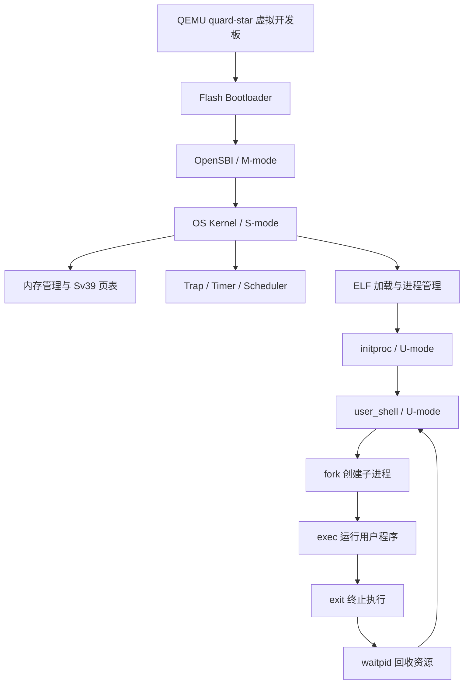

# Quard-Star RISC-V64 OS

> 基于 QEMU 自定义 RISC-V64 开发板、OpenSBI 和 Sv39 的教学型简易操作系统内核。
>
> 从启动固件到用户态程序运行，实践内存管理、异常处理、分时调度与进程生命周期管理。

## 项目简介

本项目基于 **RISC-V 64 位架构**，在 **QEMU** 中构建 `quard-star` 虚拟开发板，并移植 **OpenSBI** 完成固件启动。操作系统内核主要采用 **C 语言与 RISC-V 汇编**实现，支持物理页管理、Sv39 虚拟内存、Trap 处理、定时器中断、任务切换、ELF 用户程序加载，以及 `fork / exec / exit / waitpid` 等基础系统调用。

系统启动后首先执行 `initproc`，随后通过 `exec` 切换为交互式 `user_shell`。用户可在串口中输入应用名称，由 Shell 创建子进程、加载程序、等待退出并回收资源。

**项目定位：** 用于学习操作系统内核与 RISC-V 平台软件的实验性项目，并非完整的 Linux、POSIX 或生产级 RTOS。

## 已实现功能

| 模块 | 主要实现 |
| --- | --- |
| QEMU 虚拟开发板 | 自定义 `quard-star` Machine；配置 Flash、DRAM、PLIC、ACLINT/CLINT、UART、RTC 等设备 |
| 启动与固件 | Flash 启动代码、设备树 DTS/DTB、OpenSBI 平台适配，进入 S-mode 内核 |
| 物理内存管理 | 4 KiB 物理页分配与回收，支持复用释放的页面 |
| 虚拟内存 | 基于 RISC-V Sv39 的三级页表；内核与用户地址空间映射、用户栈及 Guard Page |
| 异常与中断 | Trampoline、TrapContext、`ecall` 系统调用分发、时钟中断处理 |
| 任务调度 | 使用 TaskContext 保存/恢复内核上下文，实现基于时钟中断的轮转调度 |
| ELF 加载 | 解析 ELF64 Program Header，加载 `PT_LOAD` 段，按权限映射页面并初始化 BSS |
| 进程管理 | TCB、PID、父子进程关系，支持 `fork` 创建、`exec` 替换程序映像 |
| 进程退出与回收 | `exit` 保存退出状态，`waitpid` 等待并回收子进程，空闲任务槽可复用 |
| 用户态交互 | `initproc`、`user_shell`、串口字符输入、退格处理、命令执行 |
| 构建系统 | Makefile 编译内核及用户程序，自动生成 `link_app.S` 并打包 ELF 应用 |

### 目前支持的主要系统调用

`read`、`write`、`sched_yield`、`gettimeofday`、`clone`（用于简化版 `fork`）、`execve`（用于简化版 `exec`）、`exit`，以及使用教学内核约定实现的 `waitpid`。

> 说明：这些接口是本项目的简化实现，不保证与 Linux 同名系统调用具有完整、兼容的语义。例如当前 `waitpid` 返回已回收子进程的 PID，退出码由内核日志输出。

## 系统架构与运行流程



### 进程生命周期

1. **`fork`**：查找空闲 TCB，创建子进程页表并复制父进程用户地址空间。
2. **`exec`**：根据应用名称查找内嵌 ELF，替换当前进程的用户映像与入口上下文。
3. **`exit`**：保存退出码，将任务状态设为 `Exited`，退出调度队列。
4. **`waitpid`**：父进程等待子进程结束，释放用户地址空间和进程资源，将 TCB 恢复为 `UnInit`。

其中 **PID 可以递增，但任务槽可以复用**；在 QEMU 测试中，连续运行 `xec` 至 PID 21，仍可正常退出并回收。

## 仓库结构

```text
riscv64-os/
├── os/                     # 自研内核与用户程序
│   ├── include/timeros/    # 内核/用户态头文件
│   ├── src/                # 内核、Trap、调度、页表、ELF 加载等
│   ├── lib/                # 公共支持代码与用户态系统调用封装
│   ├── user/               # initproc、user_shell、time、write、xec
│   ├── build.c             # 将用户程序打包为 link_app.S
│   ├── Makefile            # OS 构建入口
│   └── os.ld               # 内核链接脚本
├── qemu/                   # quard-star 虚拟开发板相关的 QEMU 定制代码与脚本
├── opensbi/quard_star/     # OpenSBI 平台适配代码
├── trusted_domain/        # Trusted Domain 启动/测试代码
└── README.md
```

**注意：** 本仓库保存的是项目核心源码和相关定制文件，`qemu/` 与 `opensbi/quard_star/` **不代表完整的上游 QEMU/OpenSBI 源码树**。要在新的机器上复现，需要先获取相应版本的上游源码，并集成本仓库的平台定制代码。

## 开发环境

以下是项目开发与验证时使用的环境：

| 项目 | 环境 |
| --- | --- |
| 操作系统 | Ubuntu 24.04 |
| QEMU | 11.1.2（源码构建，定制 `quard-star` 机型） |
| OpenSBI | 1.2（适配 `quard_star` 平台） |
| RISC-V 工具链 | `riscv64-unknown-elf-gcc`，开发环境使用 GCC 16.1.0 |
| 其他工具 | GNU Make、GCC、Ninja、`dtc`、Git |
| 语言 | C、RISC-V Assembly、Shell、Makefile |

QEMU 启动配置中使用 `-M quard-star -m 1G -smp 8`。**当前内核主要验证的是单核任务调度路径**，不将虚拟机的 8 Hart 配置等同于已实现完整 SMP 多核调度。

## 编译与运行

### 1. 准备完整开发工作区

在已集成定制 QEMU 和 OpenSBI 源码的工作区中，目录示例如下：

```text
quard-star-qemu/
├── qemu-11.1.2/       # 完整 QEMU 源码及本项目定制
├── opensbi-1.2/       # 完整 OpenSBI 源码及 quard_star 平台
├── os/                # 本仓库 os/ 的最新代码
└── trusted_domain/
```

请确保交叉编译器、`ninja`、`dtc` 等工具可用，并按实际安装位置配置 `PATH`。**GitHub 仓库中的精简 `qemu/` 目录不可直接替代 `qemu-11.1.2/`。**

### 2. 编译用户程序与内核

在完整开发工作区执行：

```bash
cd os
make clean_all     # 首次构建或需要彻底清理时使用
make all
```

构建过程会编译用户程序、执行 `build.out` 生成 `src/link_app.S`，随后链接 `os.elf` 并生成 `os.bin`。

### 3. 合成 Flash 镜像并启动 QEMU

返回完整 QEMU 工程目录，使用开发工作区中的集成脚本：

```bash
cd ../qemu-11.1.2
./build.sh
./run.sh
```

开发工作区的 `build.sh` 需在合成 Flash 镜像之前调用 `make -C ../os all`，将最新 `os.bin` 写入启动镜像。**本仓库目前提交的 `qemu/build.sh` 版本与该本地集成脚本尚未完全同步，直接执行它不能保证生成包含最新 OS 的 Flash 镜像。**

启动成功后，在串口控制台查看 OpenSBI 启动信息、内核初始化日志和 Shell 提示符。

## 运行示例

在 `user_shell` 中输入 `xec`：

```text
Timer OS user shell
>> xec
[xec] process started
[xec] step = 0
[xec] step = 1
[xec] step = 2
[xec] step = 3
[xec] step = 4
[xec] exiting, code = 50
[wait] pid=2 exit_code=50
shell: child 2 reaped
>>
```

重复输入 `xec`，可以验证进程创建、退出、等待和任务槽复用。也可以输入 `time` 测试子进程中的 `fork` 流程。PID 数值可能因运行过程不同而变化。

## 当前限制与后续方向

项目已经打通基础的进程生命周期，但仍存在教学内核的典型限制：

- 当前通过**内嵌 ELF 应用**启动程序，尚未实现通用文件系统及磁盘程序加载。
- `waitpid` 采用轮询并主动让出 CPU 的简化方式，尚未实现完整的睡眠/唤醒机制。
- 系统调用仅覆盖部分基础接口，不具备完整 POSIX 兼容性。
- 仍需进一步完善异常路径、内存分配失败后的资源回滚、长期运行的内存泄漏与并发验证。
- FreeRTOS 移植与 VirtIO 磁盘驱动暂不属于当前已完成范围。

后续可围绕 **进程调度与同步、内存安全、用户态接口扩展、驱动和文件系统** 继续完善。

## 参考项目

- [QEMU](https://www.qemu.org/)
- [OpenSBI](https://github.com/riscv-software-src/opensbi)
- [RISC-V International](https://riscv.org/)

本仓库用于个人学习与操作系统内核实践。项目中的平台移植部分基于上游开源项目进行适配，请同时遵守相应上游项目的许可要求。
